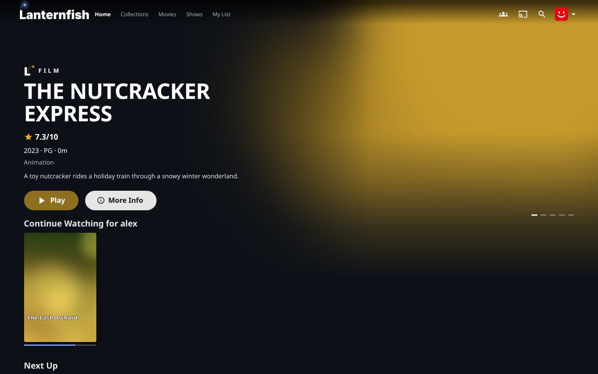
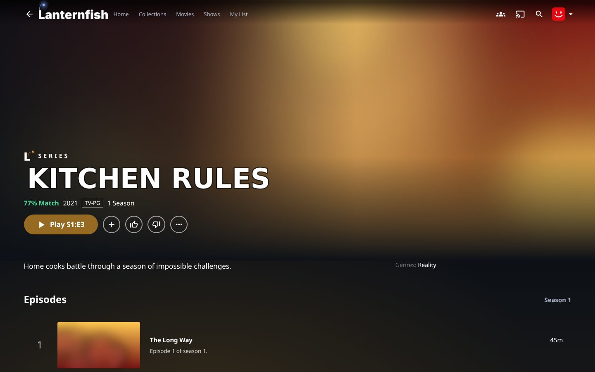
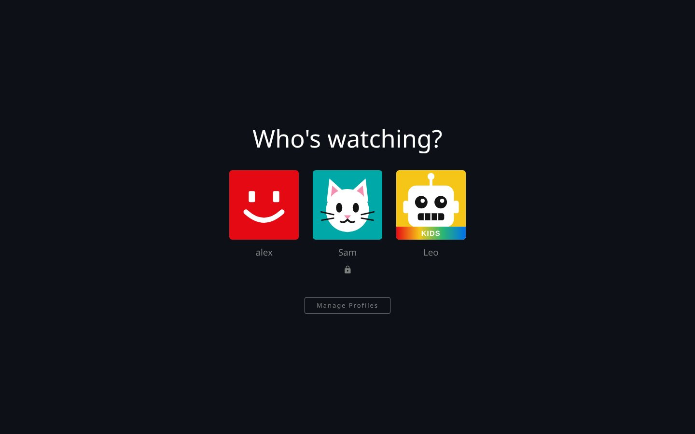
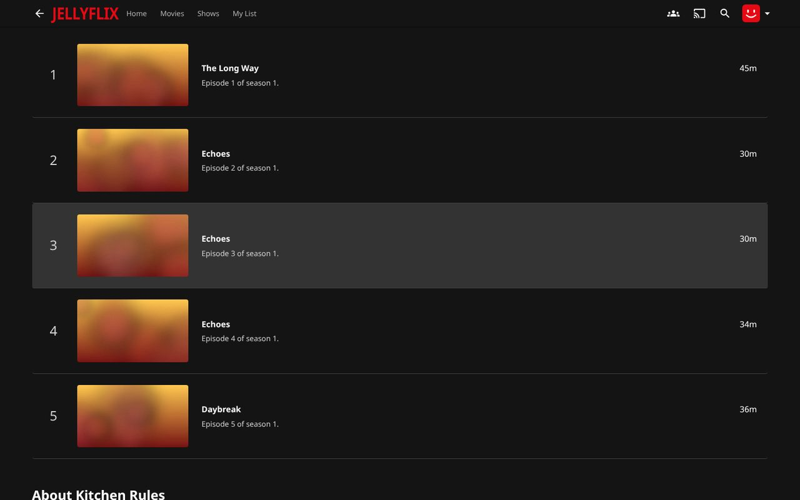
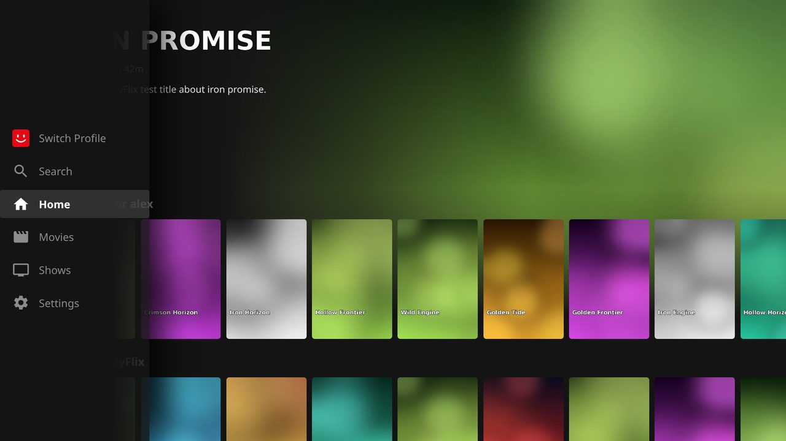
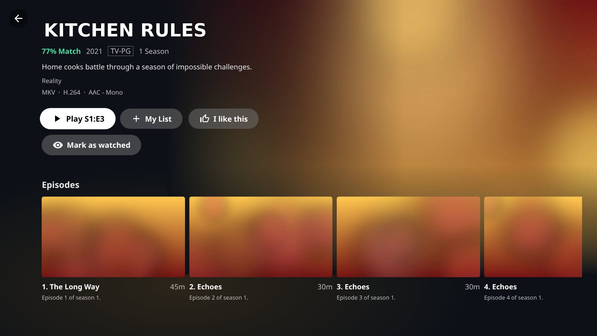
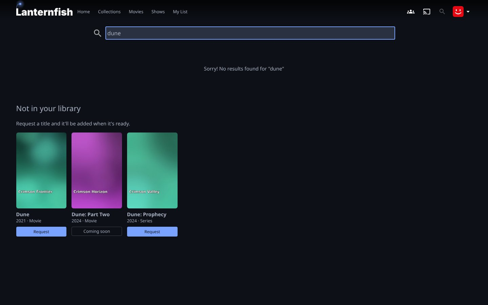
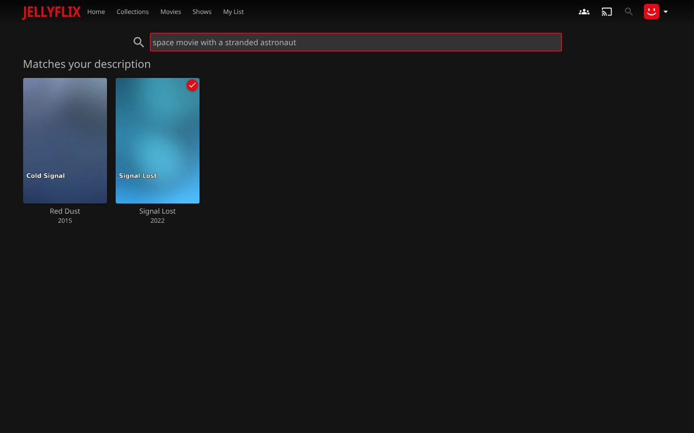
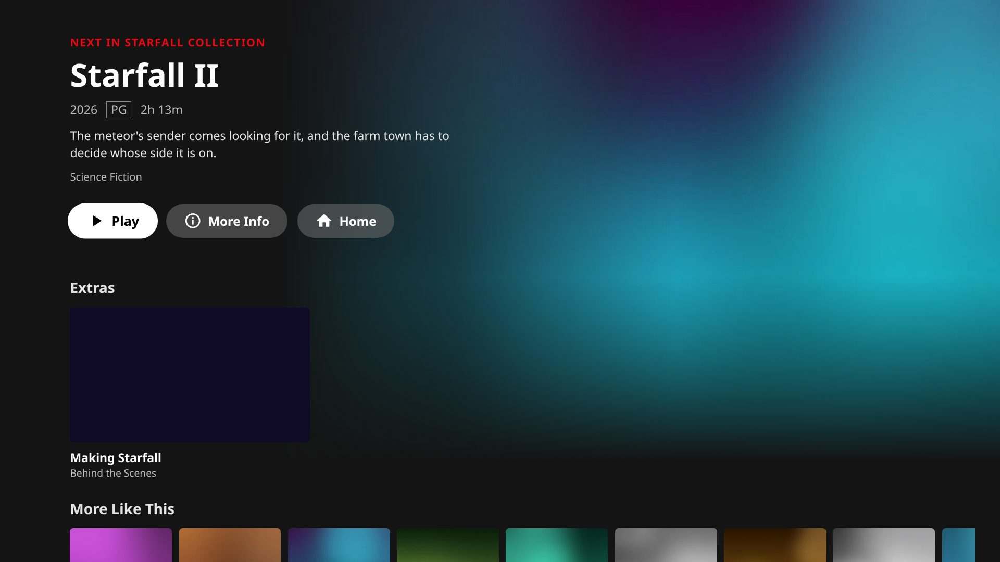

<p align="center">

</p>

<h3 align="center">A Netflix-style web client for <a href="https://jellyfin.org">Jellyfin</a></h3>

---

JellyFlix is a fork of [jellyfin-web](https://github.com/jellyfin/jellyfin-web) that makes Jellyfin look and feel like
Netflix: profiles with "Who's watching?", a home screen of poster rows, personalized recommendations, Netflix-style
title pages and a TV mode built for remote controls. Together with the
[JellyFlix plugin](https://github.com/yourmomsbasement/JellyFlix-Plugin) it is installed and kept up to date from the
Jellyfin dashboard. No files to copy and no server settings to change.

<p align="center">


</p>

<sub>Screenshots use a test library with generated artwork; your own posters and backdrops show up here.</sub>

## Features

### Profiles

One sign-in, several profiles. Each profile keeps its own watch history, Continue Watching, Next Up, My List and
parental controls. Optional 4-digit PINs, kids profiles, and "Who's watching?" every time the app opens.

<p align="center"></p>

### Home

A full-bleed hero picked from your Top Picks, then rows of 2:3 posters: Continue Watching (with *Mark as watched* and
*Remove from Continue Watching*), Next Up, Top Picks, New on JellyFlix, My List, Top Rated, *Because you watched…*,
genres and Watch It Again.

### Title pages

Backdrop and title art, match percentage, Play/Resume that picks up the right episode, trailers, My List, thumbs up and
down, seasons and episodes, More Like This, cast and crew, and a back arrow in the top bar. A **Video & Audio** section
lists the file behind the title (container, resolution and codec, HDR format, audio and subtitle tracks, size and
bitrate, for each version), and badges such as 4K, HDR, Dolby Vision, 5.1 and Atmos sit next to the year and rating.

<p align="center"></p>

### TV mode

Jellyfin's TV apps (LG webOS, Samsung Tizen, Android TV…) load the web client from your server, so they get JellyFlix
too, with no app to rebuild. In TV layout the home and title pages are rebuilt for the remote: the focused title fills
the top of the screen, rows slide as you move, Left opens the side menu, Back steps back out, the Play key starts the
focused title, and LG's Magic Remote pointer works.

<p align="center">


</p>
<p align="center"></p>

### Requests

With [Seerr](https://github.com/seerr-team/seerr) (Jellyseerr / Overseerr) set up in the JellyFlix settings, search
also shows a **Not in your library** row: matching movies and shows that the library doesn't have, each with a
**Request** button. Cards show what's already requested ("Requested"), on its way ("Coming soon") or partly
available. Requests go through the household owner's Seerr account; kids profiles don't see the row unless allowed. It
works in TV mode too.

<p align="center"></p>

### Search by description

Search also finds titles from what they're about: "space movie with a stranded astronaut" lists matching movies and
shows in a **Matches your description** row, from their plot, tagline, genres, keywords and cast. With an embeddings API
(such as Ollama) set up in the JellyFlix settings, it matches by meaning too, so "marooned on another planet" finds the
same film.

<p align="center"></p>

### Artwork per profile

**⋯ → Change artwork** on a title page lets a profile pick its own poster and background, from the library's images
and the ones metadata providers offer. Only that profile sees the change, on home, title pages and in TV mode.

<p align="center"></p>

### End-credit companion

When a movie ends, a companion page offers what to watch next: the next film in its collection with **Play**, the
movie's extras (behind the scenes, featurettes, deleted scenes…), who wrote the music and any soundtrack albums in the
music library, and More Like This. TV mode has its own version, built for the remote.

<p align="center">


</p>

### Dashboard

With the JellyFlix theme the admin dashboard gets a cleaner, more modern look: rounded cards with hairline borders,
rounded inputs with a red focus ring, a side menu of pill-shaped items with the current page in red, and a translucent
top bar. Older HTML pages, such as plugin settings, get the same treatment.

A **JellyFlix** section in the side menu opens a settings page built from the dashboard's own cards and inputs:

- **Profiles**: profiles per household, the parental rating limit for kids profiles, who may create profiles.
- **Requests**: Seerr's address and API key, kids profiles' access, and **Save and test connection**.
- **Search**: how many titles are searchable by description, semantic search with an embeddings API's address, model
  and key, **Save and test connection**, and **Build search index now** with a progress bar.
- **Web client**: the installed and latest version, whether the plugin serves it, automatic updates, and
  **Check for updates now**.

Saving happens from a bar that stays on screen and confirms the result next to the Save button; the page reads the
settings back from the server and names any it didn't keep. Testing Seerr or the embeddings API, building the search index and checking for updates each open a panel
underneath with a progress bar and then the outcome: connected (with Seerr's version) or why not, and up to date, a
new client installed (with **Reload now**) or why the update failed. The dashboard home also gets a JellyFlix card.

<p align="center">


</p>
<p align="center">


</p>

## Install

JellyFlix needs **Jellyfin 13** (the `unstable` builds).

1. In Jellyfin, open **Dashboard → Plugins → Repositories** and add
   `https://raw.githubusercontent.com/yourmomsbasement/JellyFlix-Plugin/main/manifest.json`.
2. Install **JellyFlix** from the catalog and restart Jellyfin.

That's all. The plugin downloads the newest JellyFlix web client built for your Jellyfin version, serves it in place of
the stock one, and keeps it up to date. Settings are under **JellyFlix → Settings** in the dashboard. See the
[plugin's README](https://github.com/yourmomsbasement/JellyFlix-Plugin) for details.

Search by description, artwork per profile and the end-credit companion need plugin 1.2.0 or newer; without it the
client simply leaves them out. Some settings need a recent plugin too; the settings page says so when the installed
plugin is too old. Update JellyFlix in
**Dashboard → Plugins** and restart Jellyfin.

## Releases

Every push to `master` builds the client and publishes it as a `web-<date>.<run>` GitHub release with
`jellyflix-web.zip`, its SHA-256 and `release.json` (the Jellyfin version it targets). The plugin installs these.

## Build Process

### Dependencies

- [Node.js](https://nodejs.org/en/download) 24
- npm (included in Node.js)

### Getting Started

1. Clone or download this repository.

   ```sh
   git clone https://github.com/yourmomsbasement/JellyFlix-Web.git
   cd JellyFlix-Web
   ```

2. Install build dependencies in the project directory.

   ```sh
   npm install
   ```

3. Run the web client with webpack for local development.

   ```sh
   npm start
   ```

4. Build the client with sourcemaps available.

   ```sh
   npm run build:development
   ```

Where the code lives:

| Path | What |
| --- | --- |
| `src/apps/profiles` | "Who's watching?", profile editor, PIN entry |
| `src/apps/modern/features/home`, `routes/home.tsx` | Home rows and hero |
| `src/apps/modern/features/title`, `routes/title.tsx` | Title pages |
| `src/apps/tv` | TV mode: remote navigation, TV home and title pages |
| `src/apps/dashboard/features/jellyflix`, `routes/jellyflix` | JellyFlix dashboard settings and home card |
| `src/apps/modern/features/title/utils/mediaInfo.ts` | Video & Audio details and quality badges |
| `src/themes/jellyflix/dashboard.ts` | The modern dashboard look |
| `src/apps/legacy/features/search/components/RequestResults.tsx` | Request cards under search results |
| `src/apps/legacy/features/search/components/DescriptionResults.tsx` | Matches your description row |
| `src/apps/modern/features/artwork` | Change artwork dialog and per-profile artwork |
| `src/apps/modern/features/companion`, `routes/companion.tsx`, `src/apps/tv/routes/companion.tsx` | End-credit companion |
| `src/themes/jellyflix` | The JellyFlix theme |

JellyFlix builds on the work of the [Jellyfin project](https://jellyfin.org). Review Jellyfin's
[Contributing Guide](./CONTRIBUTING.md) for more on the tech stack.
